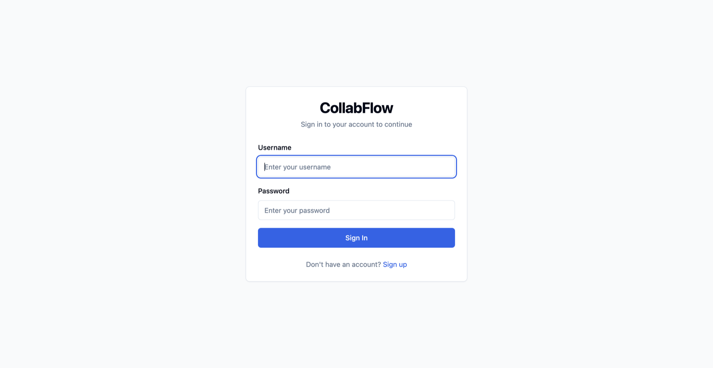
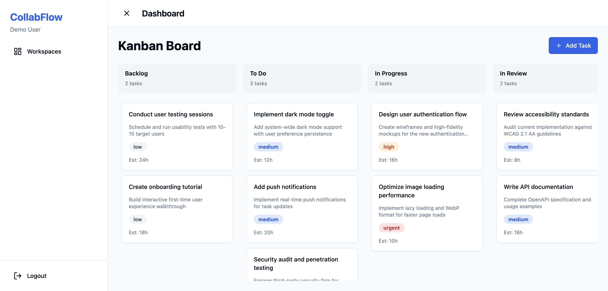
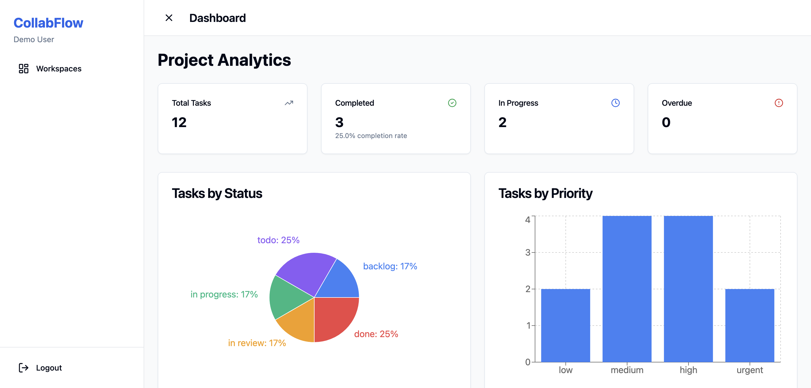
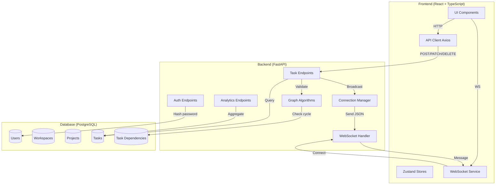

# CollabFlow

A real-time collaborative project management platform that demonstrates WebSocket synchronization, graph algorithms for dependency management, and practical full-stack engineering patterns with React, TypeScript, FastAPI, and PostgreSQL.

## What This Project Does

CollabFlow is a team project management tool with live collaboration and intelligent task scheduling. When someone moves a task from "In Progress" to "Done," everyone viewing that project sees the update instantly via WebSocket. Task dependencies form a directed acyclic graph—the system validates relationships to prevent circular dependencies and calculates critical paths to identify project bottlenecks.

The project showcases:
- **Real-time architecture**: WebSocket connection management, automatic reconnection, heartbeat monitoring
- **Algorithmic problem-solving**: Cycle detection (DFS), topological sort (Kahn's algorithm), critical path calculation
- **Distributed systems patterns**: Optimistic concurrency control with version-based conflict resolution
- **Security fundamentals**: HttpOnly cookie authentication, role-based authorization, secure password storage
- **Full-stack type safety**: Pydantic schemas on the backend, TypeScript interfaces on the frontend

## Screenshots

### Login Page

*Secure authentication with HttpOnly cookie-based JWT sessions*

### Kanban Board with Real-Time Collaboration

*Drag-and-drop task management across five workflow stages with live WebSocket updates*

### Analytics Dashboard

*Project metrics, completion trends, and graph analysis showing task dependencies and critical paths*

## The Problem

Coordinating work across a team requires visibility into what's being done, what's blocked, and what needs to happen next. Task dependencies create constraints—Task B can't start until Task A finishes—but tracking those relationships manually is error-prone. Real-time updates matter when multiple people are working on the same project: seeing changes as they happen reduces confusion and duplicate work.

CollabFlow addresses these by enforcing valid dependency graphs, broadcasting changes instantly, and providing analytics that highlight bottlenecks.

## Key Features

**Workspaces and Projects**  
Create workspaces for teams, add members with roles (owner, admin, member, viewer), and organize work into projects. Role-based permissions control who can edit, create, or delete resources.

**Kanban Board**  
Drag tasks between columns (Backlog, To Do, In Progress, In Review, Done). Task positions persist across sessions. Assign priority levels, due dates, and team members.

**Task Dependencies**  
Link tasks to enforce order: "Task B depends on Task A." The backend validates that the dependency graph remains acyclic using depth-first search. Circular dependencies are rejected with a 400 error.

**Real-Time Collaboration**  
When a task is created, updated, moved, or deleted, the backend broadcasts a WebSocket message to all users viewing that project. Clients invalidate their cache and refetch, keeping the UI in sync. Automatic reconnection with exponential backoff handles network interruptions.

**Conflict Resolution**  
Each task has a version number. If two users edit the same task simultaneously, the second update fails with a 409 Conflict. The client can retry with the latest version.

**Analytics Dashboard**  
View project metrics: task counts by status, completion rate, overdue tasks, and 7-day completion trends. The graph analysis page shows topological sort order, critical path (longest dependency chain), and total project duration based on estimated hours.

**Graph Algorithms**  
- **Cycle Detection:** DFS with three-color marking to find back edges in O(V + E) time
- **Topological Sort:** Kahn's algorithm returns a valid task execution order in O(V + E)
- **Critical Path:** Calculates earliest start times and backtracks to find the longest path through the DAG in O(V + E)

All algorithms include unit tests with various graph structures (simple chains, complex DAGs, disconnected components).

## Technology Stack

**Backend:** FastAPI (Python 3.11)  
Chosen for async support, automatic OpenAPI docs, and Pydantic validation. WebSockets integrate cleanly with FastAPI's async foundation.

**Database:** PostgreSQL 15  
Relational model fits the workspace → project → task hierarchy. Foreign keys enforce referential integrity. Alembic handles schema migrations.

**Frontend:** React 18 + TypeScript 5 + Vite  
React for component reusability, TypeScript for type safety, Vite for fast dev builds. TanStack Query manages server state caching and invalidation.

**Real-Time:** WebSockets  
Lower latency than polling. Browser automatically includes HttpOnly cookies in WebSocket handshakes for authentication.

**UI:** Tailwind CSS + Shadcn UI  
Utility-first styling with pre-built accessible components. @dnd-kit provides drag-and-drop without external dependencies on React DnD.

**Testing:** Pytest (backend), Vitest (frontend), Playwright (E2E)  
81 backend tests cover API endpoints, graph algorithms, WebSocket logic, security, and CSRF protection. 26 frontend tests cover stores, utilities, and API client behavior.

## Architecture



**Data Flow for Drag-and-Drop:**
1. User drags task from column A to column B
2. Frontend optimistically updates UI
3. Frontend sends `PATCH /api/v1/tasks/{id}` with new status and version
4. Backend validates user permissions and version match
5. Backend updates database, increments version
6. Backend broadcasts WebSocket message to all project viewers
7. All clients receive message, invalidate cache, refetch tasks
8. UI updates with confirmed data from server

## Real-Time Collaboration

**WebSocket Connection Manager**  
Maintains a map of `project_id → Set[WebSocket]`. When a user connects, the backend authenticates via cookie, verifies project access, and adds the connection to the project's room. Disconnections are detected via WebSocket close events or failed sends.

**Message Types:**
- `task_created`: New task added
- `task_updated`: Task modified (including drag-and-drop)
- `task_deleted`: Task removed
- `dependency_added`: Dependency created
- `dependency_removed`: Dependency deleted

**Automatic Reconnection:**  
Frontend WebSocket service retries on disconnect with exponential backoff: 1s, 2s, 4s, 8s, 16s (max 5 attempts). Heartbeat ping every 30 seconds detects stale connections.

**Optimistic Updates:**  
When you drag a task, the UI updates immediately. If the server rejects the change (version conflict or permission error), the client refetches and reverts to the server state.

See [ARCHITECTURE.md](./ARCHITECTURE.md) for detailed sequence diagrams and message examples.

## Authentication and Authorization

**Registration:**  
Users provide email, username, full name, and password. Password is hashed with bcrypt before storage.

**Login:**  
Backend verifies password, generates JWT, and sets it in an HttpOnly, SameSite=Lax cookie. HttpOnly prevents JavaScript from reading the token, mitigating XSS-based token theft. SameSite=Lax reduces CSRF risk by limiting cross-site cookie transmission, though complete CSRF defense requires additional measures like anti-CSRF tokens.

**Protected Routes:**  
FastAPI dependency injection extracts the JWT from cookies, validates it, and injects the current user into route handlers. Invalid or expired tokens return 401.

**Roles:**  
Workspace members have roles: owner, admin, member, viewer. Owners can delete workspaces, admins can manage members, members can edit projects/tasks, viewers can only read.

**WebSocket Authentication:**  
Browser includes cookies in WebSocket handshake. Backend extracts JWT, verifies project access, and either accepts or rejects the connection.

## Task Dependencies and Graph Algorithms

**Graph Representation:**  
Tasks are nodes, dependencies are directed edges. "Task B depends on Task A" means A → B in the graph (A must finish before B starts).

**Cycle Detection (DFS):**
```python
def has_cycle(graph: Dict[str, List[str]]) -> bool:
    WHITE, GRAY, BLACK = 0, 1, 2
    color = {node: WHITE for node in graph}
    
    def dfs(node):
        if color[node] == GRAY:  # Back edge
            return True
        if color[node] == BLACK:
            return False
        color[node] = GRAY
        for neighbor in graph[node]:
            if dfs(neighbor):
                return True
        color[node] = BLACK
        return False
    
    return any(dfs(n) for n in graph if color[n] == WHITE)
```
When adding a dependency, the backend constructs the graph and runs cycle detection. If a cycle exists, the request fails with 400 Bad Request.

**Topological Sort (Kahn's Algorithm):**  
Calculates in-degree for each node, processes nodes with in-degree 0, and outputs a valid execution order. Used to display tasks in dependency-respecting sequence.

**Critical Path:**  
Performs topological sort, calculates earliest start times by propagating durations forward, then backtracks from the node with maximum finish time. Returns the longest path and total duration in hours.

**Implementation:**  
All algorithms in `backend/app/algorithms/graph.py`. Time complexity O(V + E) for graphs with V tasks and E dependencies. Space complexity O(V + E) for adjacency lists.

**Testing:**  
9 test cases cover simple chains, complex DAGs, circular dependencies, disconnected components, and critical path calculation. Example:
```python
def test_circular_dependency_simple():
    # A -> B -> C -> A
    graph = TaskGraph()
    graph.add_task("A")
    graph.add_task("B")
    graph.add_task("C")
    graph.add_dependency("A", "B")
    graph.add_dependency("B", "C")
    graph.add_dependency("C", "A")
    assert graph.has_cycle() == True
```

## Local Setup

**Prerequisites:**  
Docker and Docker Compose installed. Ports 5433, 8001, 5174 available.

**Steps:**
```bash
# Clone repository
git clone https://github.com/Latha2308/collabflow-realtime-project-management.git
cd collabflow-realtime-project-management

# Optional: Copy environment files for customization
# (Docker Compose uses sensible defaults if .env files don't exist)
cp .env.example .env
cp frontend/.env.example frontend/.env

# Start services
docker-compose up -d

# Check status
docker-compose ps

# View logs
docker-compose logs -f backend

# Wait for "Application startup complete"
```

**Access:**
- Frontend: http://localhost:5174
- Backend API: http://localhost:8001
- API Docs: http://localhost:8001/docs
- PostgreSQL: `localhost:5433` (user: `collabflow`, db: `collabflow_db`)

**Environment Variables:**  
See `.env.example` for required variables. Docker Compose provides sensible defaults. For production, generate a strong `SECRET_KEY` and configure `DATABASE_URL`.

## Running Tests

**Backend (81 tests):**
```bash
docker-compose exec backend pytest tests/ -v
```
Covers authentication, authorization, task CRUD, dependency validation, graph algorithms, WebSocket broadcasting, security hardening, and CSRF protection.

**Frontend (26 tests):**
```bash
docker-compose exec frontend npm test -- --run
```
Unit tests for Zustand stores and utility functions.

**Lint:**
```bash
docker-compose exec backend ruff check .
docker-compose exec frontend npm run lint
```

**Build:**
```bash
docker-compose exec frontend npm run build
```
Produces a 743KB minified bundle (214KB gzipped).

**E2E (Playwright - configured but not run):**
```bash
docker-compose exec frontend npx playwright install chromium
docker-compose exec frontend npm run e2e
```
14 scenarios covering full user flows, multi-user collaboration, and circular dependency rejection.

## Engineering Challenges and Design Decisions

**WebSocket Authentication:**  
Passing JWTs in WebSocket URLs exposes tokens in logs and browser history. Using HttpOnly cookies means tokens aren't accessible to JavaScript and don't appear in URLs. The backend extracts the token from the Cookie header during the WebSocket handshake by parsing `websocket.headers.get("cookie")`.

**Optimistic Concurrency Control:**  
Without versioning, two users editing the same task could overwrite each other (lost update problem). Version numbers ensure the last write wins only if the client has the latest version. Conflicts return 409, and the client can refetch and retry.

**Broadcast vs. Direct Sync:**  
Broadcasting minimal messages (task ID, type) keeps WebSocket traffic low. Clients refetch full data from the REST API. Alternative: send complete task objects in WebSocket messages to avoid refetches, but increases message size.

**Graph Algorithm Choice:**  
DFS for cycle detection is simple and efficient. Kahn's algorithm for topological sort handles disconnected components naturally. Critical path is a standard DAG problem solved with dynamic programming on topological order.

**Single-Server Limitation:**  
Connection manager stores WebSocket connections in memory. This works for a single backend instance but doesn't scale to multiple servers. For production, use Redis pub/sub or a message broker to broadcast across instances.

**Drag-and-Drop Concurrency:**  
If two users drag the same task simultaneously, the first request succeeds and increments the version. The second request fails with 409. The losing client's optimistic UI update reverts when the refetch returns the new version.

## Current Status and Limitations

**Working:**
- Complete CRUD for workspaces, projects, tasks
- Real-time collaboration with WebSocket
- Task dependencies with cycle detection
- Analytics dashboard with charts
- Role-based access control
- Automated tests (81 backend, 26 frontend)
- Docker Compose setup
- GitHub Actions CI (backend and frontend tests)

**Limitations:**
- HTTP only (no HTTPS in development)
- In-memory WebSocket connections (no Redis for multi-server)
- No email notifications
- No file attachments
- No presence indicators (who's online)
- No conflict resolution UI (409 errors require manual retry)
- E2E tests not executed in CI yet
- No production deployment configuration

**Known Issues:**
- 26 ESLint warnings for `any` types (non-blocking)
- FastAPI deprecation warnings for `@app.on_event` (functionality works, needs migration to lifespan)

## Future Improvements

- **Timeline View:** Gantt chart with dependency arrows and date ranges
- **Presence Indicators:** Show avatars of users viewing the same project
- **Collaborative Cursors:** Real-time cursor positions during drag-and-drop
- **Email Notifications:** Daily digests, task assignments, due date reminders
- **File Attachments:** Upload images and documents to tasks
- **Advanced Search:** Elasticsearch for full-text search across tasks and comments
- **Redis Pub/Sub:** Broadcast WebSocket messages across multiple backend instances
- **Conflict Resolution UI:** Show diff when version conflicts occur, let user choose
- **Audit Logs:** Track all changes with timestamps and user IDs
- **Mobile App:** React Native or Flutter client

## Testing and Verification

All setup commands and environment variables verified against:
- `docker-compose.yml` - Service definitions, ports, environment variables
- `.env.example` - Required configuration
- Backend and frontend Dockerfiles - Build processes
- CI workflow (`.github/workflows/ci.yml`) - Automated test execution

**Verified Working:**
- `docker-compose up -d` - Starts all services
- `docker-compose logs backend` - Shows startup logs
- `docker-compose exec backend pytest` - Runs 44 tests
- `docker-compose exec frontend npm test` - Runs 10 tests
- `curl http://localhost:8001/health` - Returns `{"status":"healthy"}`
- WebSocket connection at `ws://localhost:8001/ws/{project_id}`

**No Secrets or Personal Paths:**  
README contains only example values (`your-secret-key`, `collabflow_user`). No production credentials or local file paths included.

## Additional Documentation

- **[ARCHITECTURE.md](./ARCHITECTURE.md)** - Detailed real-time collaboration architecture, message types, data flow diagrams
- **API Documentation** - http://localhost:8001/docs (Swagger UI when running)

## License

MIT License - See LICENSE file for details.
